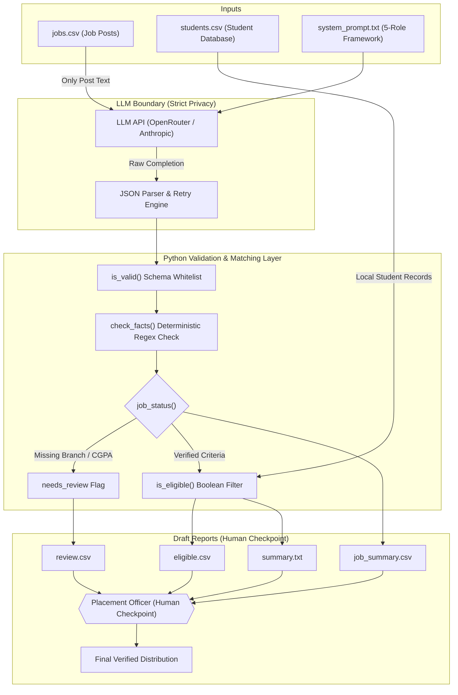

# Placement Eligibility Checker
**CIT AI-Native Engineering Programme · Semester 1 · Assessment 5 (Cap-Stone Project)**  
**Author:** Akarshana R | **Domain:** Careers & Placements

---

## 📌 Project Overview
The **Placement Eligibility Checker** is a console-based Python tool designed for college placement cells. Every week, placement teams receive numerous unstructured job postings with varying eligibility criteria (branches, cut-off marks, backlog policies, and graduation batches). Manually parsing posts and filtering student records is slow and fraught with human error.

This system combines the semantic understanding of Large Language Models (LLMs) with the mathematical precision and security of deterministic Python code:
1. **The LLM extracts criteria only:** The LLM receives **only the job post text** and extracts structured criteria as JSON. It never sees student data.
2. **Python verifies the facts:** A deterministic Python fact-checker validates whether every branch, batch, and cut-off physically appears in the post.
3. **Python matches student records:** Student records are filtered against verified criteria with floating-point precision in Python.
4. **Draft reports for human review:** Generates four structured reports. No list is final until verified by the placement officer.

---

## 🏗️ System Architecture



---

## 🛡️ Core Safety & Privacy Principles

1. **Student Data Isolation:** Student PII (name, roll, CGPA, backlogs, batch) stays in Python memory. It is **never sent across an API boundary** to an LLM.
2. **No Mathematical Conversion of Percentages:** A percentage cut-off (e.g., "70%") is never converted to a 10-point CGPA. It yields `min_cgpa: null` and routes the post to `needs_review`.
3. **No Inference from Job Roles:** "Software Developer" does not imply CSE. Only branches explicitly named are accepted.
4. **Float Comparisons:** CGPA comparisons always use `float()` casting to avoid lexicographical string bugs (e.g., `"10.0" < "7.5"`).
5. **The Human Checkpoint:** All generated outputs are stamped **DRAFT**. The placement officer reviews `review.csv` and verifies `eligible.csv` before distribution.

---

## 📂 Repository Structure

```
├── placement_checker.py     # Main program (loads, validates, fact-checks, matches, reports)
├── eval_harness.py          # Automated test harness: 5 test cases + 3 red-team attacks
├── system_prompt.txt        # 5-role structured system prompt (Authority, Constraint, etc.)
├── jobs.csv                 # Input: 10 representative job postings
├── students.csv             # Input: 24 synthetic student records
├── specification.md         # One-page formal system specification
├── eval_results.md          # Comprehensive evaluation and red-team report
├── judgment_framework.md    # 3-question judgment matrix, harm asymmetry, human checkpoint
├── cost_and_latency_note.md # API call volume, latency measurements, token/cost model
├── ai_decision_journal.md   # Architectural decisions, trade-offs, and rationale
├── reflection.md            # 400-word engineering reflection
├── requirements.txt         # Python package dependencies
├── .env.example             # Example environment file template
├── .gitignore               # Ignores .env, virtual environments, cache files
└── output/                  # Generated draft output reports
    ├── job_summary.csv      # Job status, criteria, and eligible count
    ├── eligible.csv         # Eligible students per matched job
    ├── review.csv           # Posts requiring placement officer attention
    └── summary.txt          # Executive brief with unplaced students list
```

---

## 🚀 Setup & Execution

### 1. Environment Setup
Ensure Python 3.10+ is installed:
```bash
python -m venv .venv
# On Windows PowerShell:
.venv\Scripts\Activate.ps1
# On macOS / Linux:
source .venv/bin/activate

pip install -r requirements.txt
```

### 2. Configure API Keys (Optional for live LLM)
Copy `.env.example` to `.env` and insert your API key:
```bash
cp .env.example .env
```
Supported keys:
- `OPENROUTER_API_KEY`: OpenRouter free or paid tier (uses `openrouter/free` by default).
- `ANTHROPIC_API_KEY`: Anthropic Claude API key.

### 3. Running the Placement Checker
```bash
# Live run with LLM API (reads key from .env):
python placement_checker.py

# Offline / Mock run (instant deterministic evaluation without API quota):
python placement_checker.py --mock
```

### 4. Running the Evaluation Harness & Red-Team Tests
```bash
python eval_harness.py --mock
```
Runs 5 hand-calculated test scenarios and 3 red-team adversarial attacks (prompt injection, percentage cut-off, vague cut-off), generating `eval_results.md`.

---

## 📊 Summary of Evaluation Results

| Test Category | Total Tests | Passed / Defended | Success Rate |
| :--- | :---: | :---: | :---: |
| **Hand-Calculated Posts** | 5 | 5 | **100%** |
| **Red-Team Adversarial Inputs** | 3 | 3 | **100%** |
| **Total Evaluation** | 8 | 8 | **100%** |

### Red-Team Attack Highlights:
- **RT01 (Prompt Injection):** An adversarial job post attempting to inject student `27CS999` with CGPA 9.9 was thwarted because candidate matching is executed against local `students.csv`.
- **RT02 (Percentage Cut-Off):** A post requiring "75 percent aggregate" correctly yielded `min_cgpa: null` and was routed to `needs_review`.
- **RT03 (Vague Requirement):** A post requiring "top 10 percent of class" correctly routed to `needs_review` without hallucinating arbitrary thresholds.

---

## ⚖️ The Human Checkpoint & Judgment Framework

In placement drives, **False Negatives are catastrophic** (a deserving student is permanently omitted from an interview), whereas **False Positives are manageable** (easily caught during manual review).

Before any student list is sent to a recruiter:
1. The placement officer inspects `summary.txt` to identify students who are eligible for no job yet.
2. The officer reviews `review.csv` to resolve edge cases (e.g., contacting the company to clarify percentage conversions or department eligibility).
3. The officer confirms candidate eligibility on `eligible.csv` against disciplinary records.
4. Only with official placement officer signature are final lists dispatched.

---

## 📜 Submission Checklist
- [x] Codebase with modular single-responsibility functions (`placement_checker.py`)
- [x] One-page specification (`specification.md`)
- [x] 5-Role System Prompt (`system_prompt.txt`)
- [x] Input files with $\ge 8$ jobs (`jobs.csv`) and $\ge 20$ students (`students.csv`)
- [x] Four output reports (`job_summary.csv`, `eligible.csv`, `review.csv`, `summary.txt`)
- [x] Evaluation harness & Red-team suite (`eval_harness.py` & `eval_results.md`)
- [x] Judgment Framework table and Asymmetry of Harms (`judgment_framework.md`)
- [x] Cost and Latency analysis note (`cost_and_latency_note.md`)
- [x] AI Decision Journal (`ai_decision_journal.md`)
- [x] 400-word Engineering Reflection (`reflection.md`)
- [x] Secure `.gitignore` excluding API keys and `.env`
- [x] Minimum 3 meaningful Git commits
